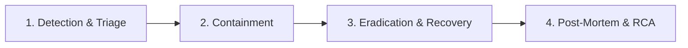

# ASTROTAG SECURITY INCIDENT RESPONSE PLAN (IRP)

**Document Version:** 1.0.0  
**Effective Date:** November 15, 2026  
**Audience:** Incident Commander, DevSecOps Engineers, Operations Team  

---

## 1. Purpose & Scope

This document establishes the official operational protocol for identifying, triaging, containing, mitigating, and documenting security incidents affecting the **Astrotag** web application, its Vercel hosting environment, and associated third-party service integrations.

---

## 2. Severity Classification Matrix

| Severity Level | Definition | Response SLA | Escalation | Examples |
| :--- | :--- | :---: | :--- | :--- |
| **SEV-1 (CRITICAL)** | Active compromise of server credentials, large-scale data breach, complete platform downtime. | **< 15 minutes** | Immediate call to Incident Commander & Leadership | Leaked `GEMINI_API_KEY` actively abused; root account takeover; critical XSS worm. |
| **SEV-2 (HIGH)** | Significant functional disruption, Denial-of-Wallet attack on AI endpoints, targeted DDoS. | **< 1 hour** | Alert DevSecOps & Lead Backend Engineer | Sustained 429 rate limit saturation; high billing spike on Google Cloud API. |
| **SEV-3 (MEDIUM)** | Non-critical vulnerability exploited, isolated user-facing bug, temporary third-party API outage. | **< 4 hours** | Assign to On-Call Engineer | Open-Meteo geocoding downtime; sporadic timeout on specific city queries. |
| **SEV-4 (LOW)** | Minor security finding, cosmetic defect, informational alert. | **< 24 hours** | Next sprint / standard backlog | Dependency vulnerability notice without active exploit vector. |

---

## 3. Incident Lifecycle Phases



### Phase 1: Detection & Triage
1. **Sources of Detection**:
   - Vercel Function Runtime Logs (spikes in 429, 413, or 500 status codes).
   - Google Cloud Billing & Quota Alerts (unexpected Gemini API credit consumption).
   - Automated uptime monitors / synthetic checks.
   - User security reports via designated contact email.
2. **Initial Triage**:
   - Verify authenticity and reproducibility.
   - Assign Severity Level (SEV-1 to SEV-4).
   - Appoint the **Incident Commander (IC)**.

### Phase 2: Containment & Isolation
1. **API Key Revocation**: If credential compromise is suspected, immediately revoke `GEMINI_API_KEY` in Google AI Studio.
2. **Edge Traffic Filtering**:
   - Enable Vercel **Attack Challenge Mode** under Project Settings.
   - Deploy IP or ASN block rules in Vercel Firewall for attacking sources.
3. **Deployment Rollback**:
   - If a newly introduced commit is vulnerable, instantaneously rollback to the previous known-good deployment via the Vercel Dashboard (`Deployments` &rarr; `...` &rarr; `Promote to Production`).

### Phase 3: Eradication & Recovery
1. **Code Patching**:
   - Develop hotfix on a dedicated hotfix branch.
   - Execute the automated security test suite (`python test_security_suite.py`) to confirm zero regressions.
2. **Credential Rotation**:
   - Issue fresh credentials and update Vercel Environment Variables.
3. **Redeployment & Verification**:
   - Deploy hotfix to production (`vercel --prod`).
   - Run end-to-end synthetic verification across all 4 core pages.

### Phase 4: Post-Mortem & Root Cause Analysis (RCA)
1. Conduct an RCA meeting within 48 hours for SEV-1 and SEV-2 incidents.
2. Document:
   - Root cause and attack vector.
   - Timeline of events (detection to resolution).
   - Financial impact (API billing, downtime cost).
   - Corrective actions and preventive controls.

---

## 4. Incident Response Playbooks

### Playbook A: Leaked or Compromised `GEMINI_API_KEY`
1. **Step 1 (Immediate)**: Log in to Google Cloud Console / Google AI Studio. Revoke the compromised key immediately.
2. **Step 2**: Generate a brand new API key.
3. **Step 3**: Update the `GEMINI_API_KEY` environment variable in the Vercel Dashboard for `Production` and `Preview`.
4. **Step 4**: Trigger an instant redeployment (`vercel --prod`).
5. **Step 5**: Audit recent billing and API usage logs in Google Cloud Console. File a billing dispute with Google Cloud Support if unauthorized usage occurred.
6. **Step 6**: Run a repository-wide Git leak scan (`gitleaks detect`) to verify no other credentials exist in commit history.

### Playbook B: AI Prompt Injection / Billing Surge (Denial-of-Wallet)
1. **Step 1**: Check the Vercel Runtime Logs to identify the offending client IP or IP range.
2. **Step 2**: Add the offending IP/subnet to Vercel Firewall Block rules.
3. **Step 3**: If attack is distributed, temporarily tighten the rate limiter in `main.py` (`limiter_ai`) from 6 requests/min to 2 requests/min.
4. **Step 4**: Verify that HTTP 429 is being returned and that Gemini API calls are not being dispatched for rate-limited requests.

### Playbook C: Cross-Site Scripting (XSS) Report
1. **Step 1**: Reproduce the reported payload locally using `test_security_suite.py`.
2. **Step 2**: Confirm whether the vulnerability is frontend (DOM-based) or backend (reflected).
3. **Step 3**: Apply `escapeHtml()` sanitization or Pydantic string stripping.
4. **Step 4**: Synchronize changes between `public/index.html` and `index.html`.
5. **Step 5**: Run tests, deploy, and verify fix in a clean browser session.

---

## 5. Communication Templates

### External Incident Notification (Status Update)
```markdown
**Investigating**: We are currently investigating an issue affecting our AI Vedic Analyst features. Chart calculation and Vimshottari Dasha calculations remain fully operational.

**Identified**: We have identified an unexpected disruption with our AI provider integration and have applied mitigation measures.

**Resolved**: The issue has been fully resolved. All AI synthesis and astrological calculation services are operating normally.
```
